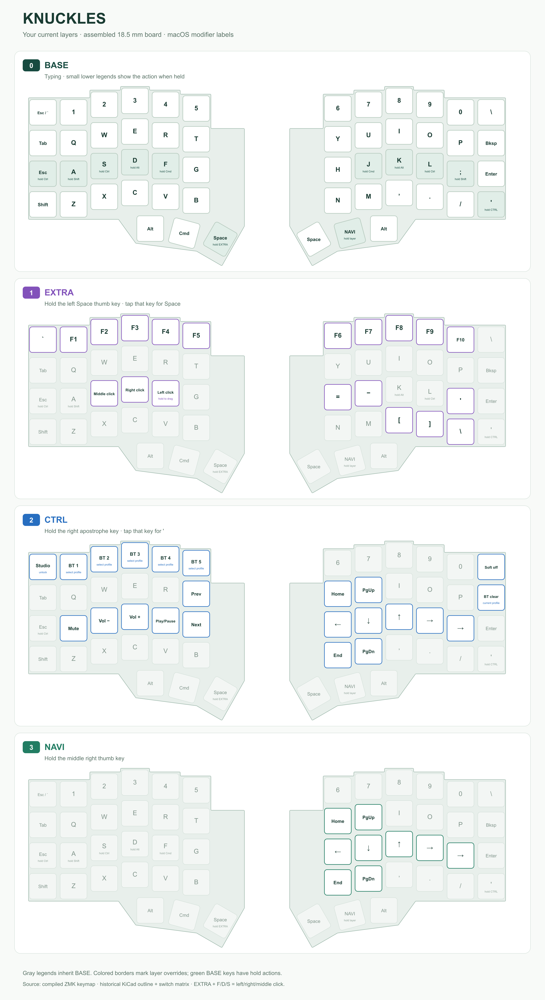

# Knuckles layers

These diagrams show the TPS43 keymap on the assembled 18.5 mm board, using
macOS modifier names. Gray keys inherit the base layer. Small lower labels
show hold actions. The EXTRA layer adds left-hand F/D/S mouse buttons.



Individual layers: [BASE](0-base.png), [EXTRA](1-extra.png),
[CTRL](2-ctrl.png), [NAVI](3-navi.png). SVG versions are alongside each PNG.

## Regenerate

Build the TPS43 right firmware first, then run from the repository root:

```sh
python3 docs/layers/render_layers.py --build-dir build/right-idle-test
```

Use `--build-dir build/knuckles_tps43_right` for the normal polling build,
or `--out /path/to/output` to render elsewhere. Requires Python 3, Git and
`rsvg-convert` (provided by `brew install librsvg` on macOS).

The renderer reads the compiled `zephyr/zephyr.dts`, checks 54 bindings per
layer, and records the source revision and UF2/devicetree SHA-256 hashes in
`sources.json`. `compiled-bindings.json` contains the decoded numeric bindings.
The source revision identifies the checkout at rendering time; rebuild before
regenerating after keymap edits so the binary and source agree.

`geometry.json` and `outline.svg` preserve the assembled board's historical
KiCad outline and switch matrix, sourced from
`fcoury/knuckles@2a7e8daed7337c88100fd3420ae1bdc2f82260e8`,
`pcbs/knuckles_wireless.kicad_pcb`. The tray silhouette comes from the legacy
18.5 mm thin-case outline. The right half mirrors the left geometry; key
positions use the firmware matrix, including the angled thumb keys.
